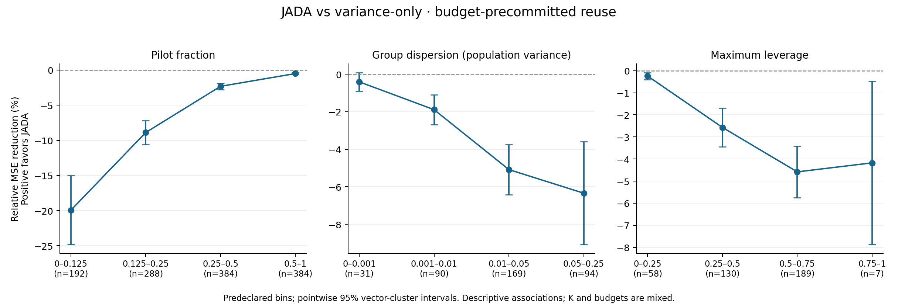

# CPU estimator gate results

Gate: **NO-GO**. Bernoulli estimator evidence; zero GPU cost.

Primary result: JADA increases MSE by **3.24%**, 95% interval **[2.89%, 3.59%]**, against variance-only with budget-precommitted reuse. It increases MSE by 4.12% against matched uniform. There is no evidence here to proceed to costly frozen-model or online training.

The primary comparison uses the predeclared equal-weight heterogeneous mixture, equally weighted K and feasible cells within K. Each probability vector is an uncertainty cluster. All 16 methods and negative results are retained.

26 feasible settings; 2652 probability-vector/settings cells; 42432 method evaluations. CPU wall time: 119.4 seconds.

| Comparison | Relative MSE reduction | 95% interval |
|---|---:|---:|
| JADA-vs-uniform/main-only | -6.76% | [-7.41, -6.12]% |
| JADA-vs-uniform/naive | -1.97% | [-2.09, -1.86]% |
| JADA-vs-uniform/fixed-0.5 | -0.22% | [-0.26, -0.18]% |
| JADA-vs-uniform/budget-precommitted | -4.12% | [-4.47, -3.77]% |
| JADA-vs-variance-only/main-only | -6.02% | [-6.67, -5.37]% |
| JADA-vs-variance-only/naive | -1.16% | [-1.25, -1.06]% |
| JADA-vs-variance-only/fixed-0.5 | 0.04% | [0.01, 0.07]% |
| JADA-vs-variance-only/budget-precommitted | -3.24% | [-3.59, -2.89]% |
| JADA-vs-oracle/main-only | -6.58% | [-7.42, -5.74]% |
| JADA-vs-oracle/naive | -1.91% | [-2.49, -1.33]% |
| JADA-vs-oracle/fixed-0.5 | -0.02% | [-0.42, 0.37]% |
| JADA-vs-oracle/budget-precommitted | -3.22% | [-3.90, -2.55]% |

| K | JADA vs variance-only, precommitted | 95% interval |
|---|---:|---:|
| 2 | 0.00% | [0.00, 0.00]% |
| 4 | -13.23% | [-15.46, -11.01]% |
| 8 | -1.37% | [-1.60, -1.13]% |
| 16 | -0.18% | [-0.23, -0.13]% |

## Original six regimes at K4/B16/m0=2

| Regime | Uniform fixed .5 MSE | JADA fixed .5 MSE | JADA reduction |
|---|---:|---:|---:|
| symmetric-wide | 0.203056515 | 0.201504672 | 0.76% |
| symmetric-mid | 0.280223984 | 0.288793640 | -3.06% |
| all-equal | 0.972346959 | 0.988913831 | -1.70% |
| near-equal | 1.649356650 | 1.671591538 | -1.35% |
| asymmetric | 0.201161472 | 0.211481752 | -5.13% |
| sparse-extreme | 0.068028536 | 0.063511899 | 6.64% |

## Diagnostic curves

The curves use predeclared bins, with paired methods and vector-cluster pointwise intervals. These are descriptive associations, not isolated causal effects: K, budget, distribution component and pilot fraction can co-vary. Empty bins are omitted. Details are in diagnostic_bins.csv; the complete crossed table is metrics.csv.

## Interpretation and limits

The declared gate requires a lower primary confidence limit above 5%, positive point estimates at each K>=4, and positive matched-reuse uniform comparison. This is a new operational threshold; the proposal only says to require consistent clear benefit. K2 has equal analytic leverage coefficients and supplies an equality boundary control, clarified before any new results.

Exact calculations cover every K2 cell and the six K4/B16/m0=2 anchors. Larger cells use 20,000 paired trials per named regime and 2,000 per heterogeneous vector. Fixed-vector intervals reflect Monte Carlo uncertainty; the primary interval reflects variation over the stratified vector distribution. It does not quantify LLM/task generalization. Sampling streams are independent with replacement and the policy is fixed.

The oracle optimizes the local surrogate and is not a nonlinear-MSE lower bound. linear_mse and surrogate_mse expose approximation failure near equal groups. Nonzero fixed .5 pilot weights retain a variance floor at large budgets. Biased naive pooling may beat an unbiased estimator in MSE.

At the symmetric-mid default, analytic norms differ from historical materialized-J arithmetic by 2.92e-5 MSE because three floating-point ties allocate to different coordinates. Other regimes have different shifts (up to about 3.96e-4 among the six anchors). Tests reproduce both arithmetic paths. Reverse-coordinate results are stored as a separate sensitivity, not used to choose the benchmark or the winner.

## Verification and evidence details

All seven tests passed, including exact covariance, finite-difference Jacobian, exhaustive integer allocator optimality, K2 boundary equality, paired-MC/exact agreement and Welch-Satterthwaite intervals. Saved-data audit confirms all 26 feasible settings and every method: 924 exact cells, 1,728 paired-MC cells and 5,184,000 paired trials. Maximum exact unbiased-value bias is 3.33e-15; covariance residual is 2.78e-16. Maximum analytic-Jacobian finite-difference error over all 408 predeclared vectors is 8.88e-7 (including the equal-group derivative of order 1,000).

For budget-precommitted JADA versus variance-only, configuration-level pointwise intervals give 15 negative settings, two inconclusive settings and nine exact K2 equalities; no positive setting. These intervals are exploratory and are not corrected for multiple comparisons. The six named regimes are stress tests kept separately from the primary mixture.

Pilot-fraction bins show relative reductions of -19.93%, -8.89%, -2.31% and -0.50% as fractions progress through [0,.125), [.125,.25), [.25,.5) and [.5,1]. Dispersion bins give -0.41%, -1.89%, -5.09%, -6.34%; leverage bins give -0.24%, -2.57%, -4.58%, -4.17%. These are descriptive associations, with their full pointwise intervals in diagnostic_bins.csv. Different bins mix different K and budgets, so they do not establish a benefit from changing pilot fraction alone.

The local surrogate fails sharply near degeneracy: at the exact all-equal K4/B16/m0=2 JADA fixed-.5 anchor, true nonlinear MSE is 0.988914 while local MSE is 50,415.04. On the heterogeneous primary weighting, oracle local MSE is 2.57165 versus variance-only 2.61985, but oracle nonlinear MSE is 0.635975 versus variance-only 0.635887. Thus even true sensitivity coefficients do not establish nonlinear benefit here; plug-in JADA adds coefficient-estimation error (local MSE 2.81142). These are point estimates, not separate claims of significant oracle superiority or inferiority.

Fixed-.5 JADA has a tiny matched variance-only gain, 0.04% [0.01%, 0.07%], but its absolute aggregate MSE (0.72044) is worse than budget-precommitted JADA (0.65648) and uniform pooling (0.63052). This ablation does not pass the primary gate. Uniform pooling exactly equals uniform budget-precommitted reuse, providing a full-total-budget baseline.

Reverse-coordinate checks can shift specific regime improvements: sparse-extreme at B16 changes from +6.64% to approximately +10.13%; asymmetric remains negative (about -5.13% to -3.49%). This underscores tie ownership sensitivity, without changing the predeclared mixture or the primary result. The sensitivity uses separate paired-MC trials, with order-difference intervals in tie_sensitivity_summary.csv.

Review independence remains same-family, acceptance provisional. The fresh reviewer cleared the implementation after two blockers were corrected before sampling. See ../../EXPERIMENT_CODE_REVIEW.md. Environment and quantitative checks are recorded in verification.json; all sixteen aggregate risks are in aggregate_risks.csv; setting-level comparisons are in configuration_summary.csv.

Reproduce: `python -m unittest discover -s tests -v`, then `python -m experiments.cpu_gate.run --output <new-directory>`. Distribution and vectors are saved before sampling. Read DERIVATIONS.md for the exact covariance and surrogate proofs. No frozen-model or online run is authorized by these results alone.
