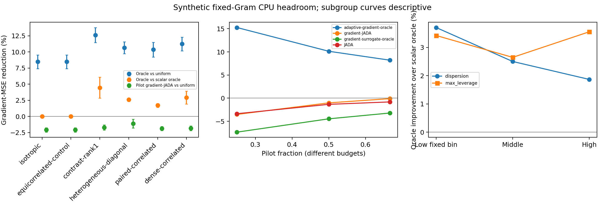

# Synthetic fixed-Gram gradient-MSE CPU gate

**NO_OBJECTIVE_SPECIFIC_SIGNAL**. Information headroom only; GPU cost0.

Scope K4, B16/m0=1,2 and B24/m0=4, budget-precommitted reuse. Fixed trace-one PSD Grams supplied by the synthetic model independently of p and outcomes. This is not measured LLM score geometry or reward-score dependence.

Fresh confirmation retains all96 vectors (seed1732052026),16 per unchanged probability-mixture component. Prior confirmation is development; six named stress regimes retained. Primary equally weights four predeclared nontrivial Grams and three settings within each vector; interval sample count remains96.

| Primary comparison | Relative gradient-MSE reduction | CI95 |
|---|---:|---|
| adaptive-gradient-oracle-vs-uniform | 11.358% | [10.363%, 12.353%] |
| adaptive-gradient-oracle-vs-adaptive-scalar-oracle | 3.091% | [2.392%, 3.789%] |
| fixed-gradient-oracle-vs-uniform | 6.055% | [4.862%, 7.249%] |
| gradient-surrogate-oracle-vs-uniform | -5.102% | [-6.644%, -3.559%] |
| gradient-JADA-vs-uniform | -1.623% | [-1.977%, -1.268%] |
| JADA-vs-uniform | -1.891% | [-2.251%, -1.531%] |

Both oracle lower95 limits must exceed5% for HEADROOM_FOR_GRADIENT_CPU. This decision does not declare gradient-JADA successful. True-p oracles remain unavailable-information controls; known fixed G is supplied by the toy design rather than learned from pilots.

The objective-specific point effect is positive and its interval excludes zero; NO_OBJECTIVE_SPECIFIC_SIGNAL means failure of the predeclared material-benefit criterion, not proof that Gram weighting has no effect. The extra oracle gain is3.091% [2.392%,3.789%], below5%. The known-G pilot gradient-JADA increases weighted error1.623%, and even the true-p local surrogate increases it5.102%. Changing the local coefficient alone has not repaired the surrogate mismatch under this benchmark.

| Gram | Weighted oracle vs uniform | Weighted vs scalar adaptive oracle | Pilot gradient-JADA vs uniform |
|---|---:|---:|---:|
| isotropic | 8.467% | 0.000% | -2.096% |
| equicorrelated-control | 8.467% | 0.000% | -2.096% |
| contrast-rank1 | 12.608% | 4.453% | -1.718% |
| heterogeneous-diagonal | 10.640% | 2.587% | -1.118% |
| paired-correlated | 10.350% | 1.716% | -1.871% |
| dense-correlated | 11.242% | 2.920% | -1.828% |
| aligned-null | Zero absolute loss | Relative ratios undefined | Zero absolute loss |

Isotropic equals the scalar loss exactly. Equicorrelated-control is exactly half the scalar loss on centered credits. Aligned-null annihilates all credit errors. These controls are reported but excluded from the objective-specific primary average; no Gram was selected after observing winners.

Confidence intervals are stratified paired vector-cluster Welch-Satterthwaite t delta intervals across the unchanged six probability strata. Reward count states, allocation candidates and risks are exact; repeated Grams/settings are not independent observations. Fixed-bin subgroup curves are descriptive. Pilot fraction curves change budgets and do not isolate a causal pilot effect.

Completed 4158 cells and 37422 method evaluations. CPU wall time 27.7s. Review: same-family provisional: GPT-6-Astra xhigh fresh review; no blocking correctness issues. See AUDIT.json for independent saved-table minima, scalar/null boundaries and direct weighted-risk checks.

The gate fails its predeclared objective-specific threshold. Preserve the negative outcome rather than choosing a winning Gram subset or changing the probability distribution. A further method requires a distinct hypothesis and a new protocol/confirmation; this result does not justify launching a weighted posterior policy automatically. No claim about all possible score geometries follows from these fixed matrices. No training, real LLM-gradient or GPU benefit has been established. The confirmation set is consumed.
