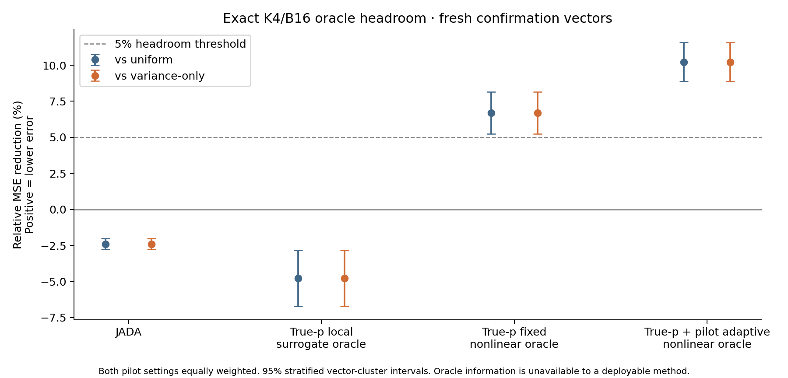

# Exact nonlinear-oracle CPU gate

Headroom decision: **HEADROOM**. This is not an online-training GO.

Scope: K4, total budget 16, m0=1 or 2, budget-precommitted reuse. Fresh confirmation: 96 vectors in six equal-weight distribution components, seed 2718282026, committed before evaluation. Development: previous 96 vectors plus six stress regimes.

Every positive integer main allocation was enumerated: 165 at m0=1 and 35 at m0=2. Each conditional main count distribution and pilot count probability is integrated exactly. There is no reward Monte Carlo error or noisy winner-selection bias.

At this budget, variance-only is exactly uniform for both pilot settings: m0=1 has identical posterior variance proxies; m0=2/B_main=8 yields [2,2,2,2] for every pilot state. The two primary baseline comparisons therefore coincide and are not independent evidence.

Fixed nonlinear oracle knows p and selects counts before pilots. Adaptive nonlinear oracle knows p and the realized pilots and selects counts before fresh main sampling. Neither is deployable when p is unknown. True-p information permits the adaptive oracle to react to realized pilot errors; its headroom need not be learnable from pilots alone.

| Fresh confirmation comparison | Relative MSE reduction | 95% interval |
|---|---:|---:|
| JADA-vs-uniform | -2.40% | [-2.78, -2.02]% |
| JADA-vs-variance-only | -2.40% | [-2.78, -2.02]% |
| local-surrogate-oracle-vs-uniform | -4.78% | [-6.73, -2.83]% |
| local-surrogate-oracle-vs-variance-only | -4.78% | [-6.73, -2.83]% |
| fixed-nonlinear-oracle-vs-uniform | 6.70% | [5.24, 8.16]% |
| fixed-nonlinear-oracle-vs-variance-only | 6.70% | [5.24, 8.16]% |
| adaptive-nonlinear-oracle-vs-uniform | 10.22% | [8.87, 11.57]% |
| adaptive-nonlinear-oracle-vs-variance-only | 10.22% | [8.87, 11.57]% |

| Method | Fresh confirmation MSE |
|---|---:|
| uniform | 0.741443132 |
| variance-only | 0.741443132 |
| JADA | 0.759245009 |
| local-surrogate-oracle | 0.776868774 |
| fixed-nonlinear-oracle | 0.691773891 |
| adaptive-nonlinear-oracle | 0.665657145 |

| m0 | Adaptive oracle vs uniform | vs variance-only | Fixed oracle vs uniform |
|---|---:|---:|---:|
| 1 | 12.42% | 12.42% | 8.92% |
| 2 | 8.02% | 8.02% | 4.48% |

| Original stress regime, m0=2 | Uniform MSE | Fixed nonlinear oracle | Adaptive nonlinear oracle |
|---|---:|---:|---:|
| symmetric-wide | 0.203057 | 0.202075 | 0.199209 |
| symmetric-mid | 0.280224 | 0.280224 | 0.278723 |
| all-equal | 0.972347 | 0.972347 | 0.960622 |
| near-equal | 1.649357 | 1.649357 | 1.572898 |
| asymmetric | 0.201161 | 0.201161 | 0.199109 |
| sparse-extreme | 0.068029 | 0.055178 | 0.055170 |

## Decision and limits

There is clear oracle headroom at this budget. The next justified step is a separate CPU pilot-only allocator that targets expected nonlinear error. Keep the original JADA NO-GO intact; the oracle is not that method.

The declared headroom criterion requires both primary lower confidence limits to exceed 5%. Population intervals cluster both pilot settings inside each probability vector and use six stratified paired covariance estimates with contrast-specific Welch-Satterthwaite degrees of freedom. These nominal pointwise intervals characterize the declared distribution; they do not establish LLM generalization.

Confirmation examples were not used to tune a method. Both oracle policies are mathematically specified optimizers rather than search-selected algorithms. The exact adaptive oracle dominates each baseline at each pilot state; the fixed oracle dominates every fixed-count policy, including uniform and the local-surrogate oracle, but need not dominate a pilot-adaptive variance-only policy.

This small gate does not cover total budgets 32/64, other K, alternative reuse or training. A negative result here cannot establish impossibility at larger budgets. A positive oracle result permits a separate pilot-only method-development experiment; it does not authorize GPU or online training.

CPU solve/report wall time: 1.65 seconds. GPU hours and cost: 0.

Artifacts: metrics.csv and results.jsonl contain all six methods; exact_risks_m0_*.npz contain every conditional risk, pilot probability, allocation and selected index. verification.json checks exhaustive coverage, exact dominance, raw-value unbiasedness and risk bounds. Read DERIVATIONS.md in experiments/nonlinear_oracle for the proofs.

Independent saved-table audit: PASS, 396 exact cells and 2,376 method evaluations. Allocation coverage was independently reconstructed using separator enumeration. Every stored adaptive choice attains the minimum conditional risk; every fixed choice attains the minimum unconditional risk. Reported metrics match the saved tables exactly, and direct squared-error enumeration checks differ by at most 9.99e-16. All 12 tests pass, including deliberate corruption of an oracle policy that the audit rejects. Fresh code review is same-family provisional; see CODE_REVIEW.md.
