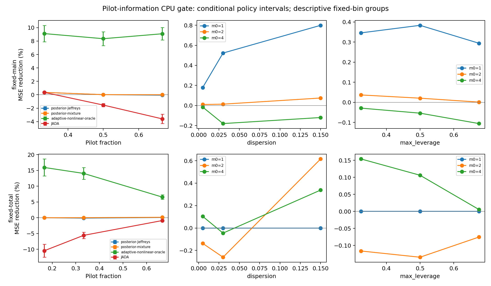

# Pilot-information CPU gate

**NO_CLEAR_SIGNAL**. GPU cost 0. Implementation review: local-only; delegated reviewer unavailable (usage limit).

Unchanged six-component mixture; 96 fresh vectors (seed1618032026) plus six stress regimes saved before fitting. Jeffreys primary; known-mixture secondary cannot rescue a failed primary. All positive integer allocations and pilot/main count states are enumerated exactly. Continuous prior integration is approximate; intervals are stratified paired vector-cluster t intervals conditional on frozen policies.

| Arm | m0 | Total/main | Reuse lambda | Method vs uniform | MSE reduction | CI95 |
|---|---:|---|---:|---|---:|---|
| fixed-main | 1 | 12/8 | 0.500 | posterior-Jeffreys | 0.351% | [0.300%, 0.401%] |
| fixed-main | 1 | 12/8 | 0.500 | posterior-mixture | 0.351% | [0.300%, 0.401%] |
| fixed-main | 1 | 12/8 | 0.500 | JADA | 0.350% | [0.292%, 0.409%] |
| fixed-main | 1 | 12/8 | 0.500 | adaptive-nonlinear-oracle | 9.113% | [7.880%, 10.347%] |
| fixed-main | 2 | 16/8 | 0.500 | posterior-Jeffreys | 0.017% | [0.005%, 0.028%] |
| fixed-main | 2 | 16/8 | 0.500 | posterior-mixture | 0.017% | [0.005%, 0.028%] |
| fixed-main | 2 | 16/8 | 0.500 | JADA | -1.536% | [-1.779%, -1.293%] |
| fixed-main | 2 | 16/8 | 0.500 | adaptive-nonlinear-oracle | 8.354% | [7.321%, 9.387%] |
| fixed-main | 4 | 24/8 | 0.500 | posterior-Jeffreys | -0.066% | [-0.110%, -0.022%] |
| fixed-main | 4 | 24/8 | 0.500 | posterior-mixture | 0.002% | [-0.014%, 0.018%] |
| fixed-main | 4 | 24/8 | 0.500 | JADA | -3.595% | [-4.295%, -2.894%] |
| fixed-main | 4 | 24/8 | 0.500 | adaptive-nonlinear-oracle | 9.088% | [8.158%, 10.018%] |
| fixed-total | 1 | 24/20 | 0.167 | posterior-Jeffreys | 0.000% | [-0.000%, 0.000%] |
| fixed-total | 1 | 24/20 | 0.167 | posterior-mixture | 0.000% | [-0.000%, 0.000%] |
| fixed-total | 1 | 24/20 | 0.167 | JADA | -10.441% | [-12.502%, -8.380%] |
| fixed-total | 1 | 24/20 | 0.167 | adaptive-nonlinear-oracle | 15.916% | [13.221%, 18.611%] |
| fixed-total | 2 | 24/16 | 0.333 | posterior-Jeffreys | -0.115% | [-0.153%, -0.076%] |
| fixed-total | 2 | 24/16 | 0.333 | posterior-mixture | 0.015% | [0.008%, 0.022%] |
| fixed-total | 2 | 24/16 | 0.333 | JADA | -5.578% | [-6.578%, -4.579%] |
| fixed-total | 2 | 24/16 | 0.333 | adaptive-nonlinear-oracle | 14.036% | [12.159%, 15.914%] |
| fixed-total | 4 | 24/8 | 0.667 | posterior-Jeffreys | 0.083% | [0.030%, 0.136%] |
| fixed-total | 4 | 24/8 | 0.667 | posterior-mixture | 0.145% | [0.082%, 0.208%] |
| fixed-total | 4 | 24/8 | 0.667 | JADA | -0.891% | [-1.076%, -0.707%] |
| fixed-total | 4 | 24/8 | 0.667 | adaptive-nonlinear-oracle | 6.545% | [5.808%, 7.282%] |

Paired fixed-main absolute MSE gain trend (m0=4 minus m0=1): -0.003417, CI95 [-0.0038093676909561687, -0.0030245966185910226]. This tests gains relative to each matched uniform control; it is not total-cost improvement.

The fixed-main arm holds main8 and lambda=.5 but spends total12/16/24. The fixed-total arm spends total24 and uses main20/16/8 with budget-precommitted reuse. Fixed-main benefit alone cannot establish equal-cost value.

Primary information gate: Jeffreys lower CI95 >5% at fixed-main/m0=4. Practical gate additionally requires >5% at fixed-total/m0=4 and positive points in every fixed-total setting. Neither is a training GO.

All methods versus variance-only are also retained in summary.json; variance-only may differ from uniform at m0=4. Metrics.csv/results.jsonl preserve stress and confirmation results. Fixed bins were committed before confirmation; subgroup lines are descriptive, without significance claims.

## Integration stability

| Prior | Setting | Weighted half-policy TV | Changed histories | Max paired scramble SE |
|---|---|---:|---:|---:|
| posterior-Jeffreys | fixed-main-m0-1 | 0.00000 | 0 | 0.00006 |
| posterior-Jeffreys | fixed-main-m0-2 | 0.00000 | 0 | 0.00007 |
| posterior-Jeffreys | fixed-main-m0-4 | 0.00000 | 0 | 0.00029 |
| posterior-Jeffreys | fixed-total-m0-1 | 0.00000 | 0 | 0.00000 |
| posterior-Jeffreys | fixed-total-m0-2 | 0.00000 | 0 | 0.00009 |
| posterior-Jeffreys | fixed-total-m0-4 | 0.04991 | 16 | 0.00075 |
| posterior-mixture | fixed-main-m0-1 | 0.00000 | 0 | 0.00006 |
| posterior-mixture | fixed-main-m0-2 | 0.00000 | 0 | 0.00013 |
| posterior-mixture | fixed-main-m0-4 | 0.00000 | 0 | 0.00035 |
| posterior-mixture | fixed-total-m0-1 | 0.00000 | 0 | 0.00000 |
| posterior-mixture | fixed-total-m0-2 | 0.00000 | 0 | 0.00005 |
| posterior-mixture | fixed-total-m0-4 | 0.00000 | 0 | 0.00026 |

Integration uses {'seed': 5772152026, 'replicates': 4, 'Jeffreys_points_per_replicate': 256, 'mixture_points_per_component_per_replicate': 64}; selected by development-only runtime profiling. Nonzero policy disagreement limits claims about continuous Bayes optimality. No integration size/prior changes followed confirmation outcomes.

## Interpretation

Neither predeclared gate passes. Increasing pilot size to four does not recover material allocation benefit for these frozen posterior policies. At fixed main8/lambda=.5, primary Jeffreys worsens MSE by 0.066%; the correctly benchmark-informed secondary has only 0.002% gain with an interval spanning zero. At fixed total24/m0=4, primary gains 0.083% and secondary gains 0.145%, far below the 5% criterion. True-p oracle headroom persists; this is not proof that all pilot-only methods are impossible.

The negative fixed-main gain trend and modest matched-cost improvements do not support moving this allocator family to model training. Preserve the distribution and negative results. A further experiment requires a distinct hypothesis, rather than a winner-selected subset or more confirmation tuning. Primary fixed-total/m0=4 also has quadrature-policy disagreement, so its interval must remain conditional on this frozen approximation.

Audit PASS: 612 exact cells, 3672 method evaluations; direct risk residual 4.44e-16, raw value bias 4.44e-16. Counts remain positive and fixed before independent main sampling. CPU fit/evaluation time 480.7s. The confirmation set is now consumed.
