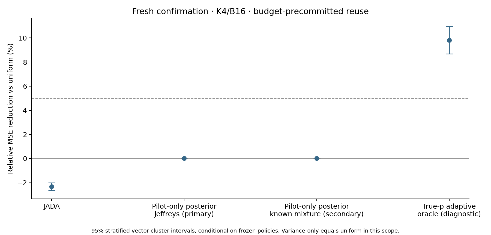

# Pilot-only posterior nonlinear allocator

Primary decision: **NO_CLEAR_SIGNAL**. CPU evidence only.

Scope: K4/B16/m0=1,2, raw budget-precommitted reuse. Offline policy construction receives only the declared prior and numeric integration seeds. Runtime allocation receives only pilot counts and independent tie randomization; no true p or main outcomes.

Primary: independent Jeffreys Beta(.5,.5) prior. Secondary: the known six-component synthetic benchmark population prior. The secondary cannot replace a failed primary and is not distribution-free evidence.

Fresh confirmation: 96 vectors from the unchanged mixture, seed 3141592026 saved before evaluation. Previously inspected examples are development/stress only and were not used as integration points or to tune priors.

| Confirmation comparison | Relative MSE reduction | 95% interval |
|---|---:|---:|
| JADA-vs-uniform | -2.33% | [-2.65, -2.02]% |
| JADA-vs-variance-only | -2.33% | [-2.65, -2.02]% |
| posterior-Jeffreys-vs-uniform | 0.01% | [0.01, 0.02]% |
| posterior-Jeffreys-vs-variance-only | 0.01% | [0.01, 0.02]% |
| posterior-mixture-vs-uniform | 0.01% | [0.01, 0.02]% |
| posterior-mixture-vs-variance-only | 0.01% | [0.01, 0.02]% |
| adaptive-nonlinear-oracle-vs-uniform | 9.82% | [8.68, 10.95]% |
| adaptive-nonlinear-oracle-vs-variance-only | 9.82% | [8.68, 10.95]% |

Uniform and variance-only coincide under both declared settings; these paired comparisons are the same control.

| m0 | Jeffreys reduction vs uniform | Mixture reduction vs uniform |
|---|---:|---:|
| 1 | 0.00% | 0.00% |
| 2 | 0.02% | 0.02% |

## Numeric integration and exact evaluation

Each posterior policy uses eight independent scrambled Sobol replicates: 8,192 prior points for Jeffreys and 12,288 stratified prior points for the mixture. Counts and reward states are enumerated exactly at each integration point. Joint pilot-likelihood-weighted risk numerators and masses are averaged before posterior division, then symmetrized over all 24 thought permutations. Ties within 1e-12 are randomized uniformly, preserving exchangeability.

Policy construction approximates the continuous posterior integral; it does not certify exact Bayes optimality. Construction diagnostics record scramble variability and first-half/last-half policy disagreement. Fresh-vector MSE integrates all pilot/main outcomes and tie probabilities exactly. Population confidence intervals are conditional on these frozen policies; prior integration variability is reported separately.

| Prior | m0 | Half-scramble weighted policy TV | Max selected-risk SE |
|---|---:|---:|---:|
| posterior-Jeffreys | 1 | 0.000000 | 0.001615 |
| posterior-Jeffreys | 2 | 0.000000 | 0.002961 |
| posterior-mixture | 1 | 0.000000 | 0.001333 |
| posterior-mixture | 2 | 0.000000 | 0.002318 |

## Interpretation

The primary pilot-only method does not pass the declared CPU criterion. Keep the negative outcome; the secondary benchmark-informed prior cannot rescue this primary gate. Oracle headroom does not guarantee recoverable pilot-only gains.

The predeclared primary criterion is a lower 95% reduction limit above 5% with positive point estimates at both m0 settings. The true-p adaptive oracle remains an information upper comparator, not a deployed policy. No result here establishes gradient, training or LLM improvement, or benefit at larger K/budgets.

Raw value estimates remain unbiased: counts are positive and committed before independent main sampling, with lambda fixed before pilots. A policy may use auxiliary tie randomness independent of main rewards without changing that proof. Normalized advantages remain nonlinear and may be biased.

No prior was switched or sample count increased after confirmation outcomes. This confirmation set is now consumed. See exact_evaluation_m0_*.npz for all risks and selected oracle policies, policy_*.json for executable pilot-only tables, integration_*.npz for prior integrals, metrics.csv/results.jsonl for complete results, and AUDIT.json for verification.

CPU fit/evaluation wall time: 110.80s. GPU cost: 0. Review status: same-family provisional.
