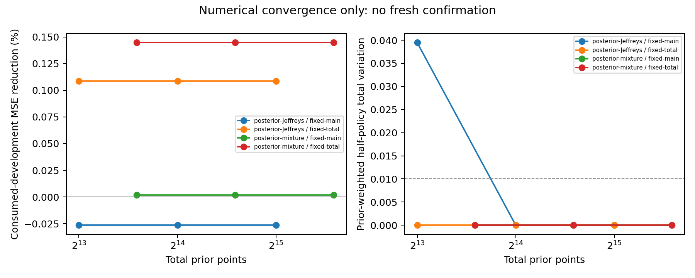

# Final posterior convergence diagnosis

**RECOMMEND_STOP_CURRENT_ALLOCATOR_FAMILY**. Original gate remains NO_CLEAR_SIGNAL.

Two m0=4 settings; unchanged priors and probability-vector distribution. Eight independently scrambled Sobol replicates and three nested component-balanced levels were committed before this run. Chunking pools joint numerators/masses without averaging posterior ratios. Exact finite reward risks are used at every prior point. No fresh confirmation or new reward sampling.

| Prior | Setting | Prior points | Half-policy TV | TV vs original | Development reduction |
|---|---|---:|---:|---:|---:|
| posterior-Jeffreys | fixed-main-m0-4 | 8192 | 0.039467 | 0.039505 | -0.0264% |
| posterior-Jeffreys | fixed-main-m0-4 | 16384 | 0.000000 | 0.039390 | -0.0264% |
| posterior-Jeffreys | fixed-main-m0-4 | 32768 | 0.000000 | 0.039408 | -0.0264% |
| posterior-Jeffreys | fixed-total-m0-4 | 8192 | 0.000000 | 0.056583 | 0.1088% |
| posterior-Jeffreys | fixed-total-m0-4 | 16384 | 0.000000 | 0.056626 | 0.1088% |
| posterior-Jeffreys | fixed-total-m0-4 | 32768 | 0.000000 | 0.056616 | 0.1088% |
| posterior-mixture | fixed-main-m0-4 | 12288 | 0.000000 | 0.000000 | 0.0020% |
| posterior-mixture | fixed-main-m0-4 | 24576 | 0.000000 | 0.000000 | 0.0020% |
| posterior-mixture | fixed-main-m0-4 | 49152 | 0.000000 | 0.000000 | 0.0020% |
| posterior-mixture | fixed-total-m0-4 | 12288 | 0.000000 | 0.000000 | 0.1447% |
| posterior-mixture | fixed-total-m0-4 | 24576 | 0.000000 | 0.000000 | 0.1447% |
| posterior-mixture | fixed-total-m0-4 | 49152 | 0.000000 | 0.000000 | 0.1447% |

1. Observation: the table records gains and policy agreement as numerical integration increases. Development risks use the previous 96-vector confirmation, now consumed; all six stress cases remain in metrics.csv.
2. Interpretation: stable tiny gains support stopping this allocator family under the tested model and objectives. Instability instead leaves the numerical diagnosis open. These are approximate policies, not certified exact continuous Bayes optima or an impossibility theorem.
3. Implication: this analysis cannot reverse the original gate or create a new confirmation pass. Reported scramble SEs are diagnostics conditional on a policy selected using these scrambles, not independent optimal-risk uncertainty intervals.
4. Next step: if stopping is recommended, revisit whether normalized-advantage MSE predicts token-weighted gradient MSE before further allocator sweeps. Any new method needs a distinct hypothesis and new preregistered confirmation; no GPU or online training is justified by this diagnosis.

Audit PASS; policy reconstruction, oracle dominance and balanced nested prefixes checked. CPU time 514.3s. GPU cost0. Review is local diagnostic, with no fresh reviewer clearance.
