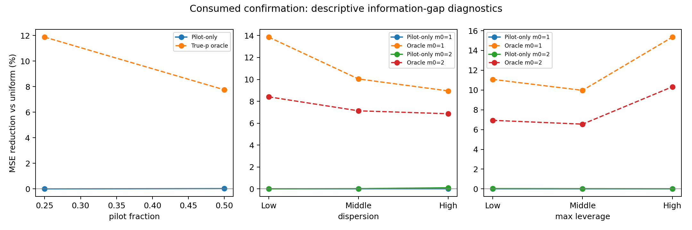

# Posterior allocator information-gap diagnosis

Post hoc descriptive analysis of consumed confirmation. No policy refit, new outcomes or new independent evidence. K4/B16, budget-precommitted reuse; equal 16-vector strata. Subgroup cutpoints are empirical tertiles chosen without comparing winners; no subgroup significance claims.

For each pilot h, uniform-to-oracle gain = uniform-to-frozen-policy gain + frozen-policy-to-oracle regret. This identity is verified against all saved count risks. The remaining regret is an information comparator gap, not a proven lower bound for all pilot-only methods.

| m0 | Pilot fraction | Pilot-only reduction | Oracle reduction | Oracle gain recovered | Nonuniform allocation probability |
|---|---:|---:|---:|---:|---:|
| 1 | 0.25 | 0.0000% | 11.88% | 0.000% | 0.00% |
| 2 | 0.50 | 0.0250% | 7.76% | 0.322% | 9.08% |

The frozen policies use uniform counts at all 16 m0=1 histories and deviate in only eight of 81 m0=2 histories. Increasing pilot fraction here also decreases the main budget and changes reuse weight; two points do not isolate a causal effect of pilot information.

| m0 | Feature | Group | Vectors | Pilot-only reduction | Oracle reduction |
|---|---|---|---:|---:|---:|
| 1 | component | 0 | 16 | 0.0000% | 11.75% |
| 1 | component | 1 | 16 | 0.0000% | 4.69% |
| 1 | component | 2 | 16 | 0.0000% | 4.19% |
| 1 | component | 3 | 16 | 0.0000% | 26.25% |
| 1 | component | 4 | 16 | 0.0000% | 26.22% |
| 1 | component | 5 | 16 | 0.0000% | 6.99% |
| 1 | dispersion | 0 | 32 | 0.0000% | 13.86% |
| 1 | dispersion | 1 | 32 | 0.0000% | 10.04% |
| 1 | dispersion | 2 | 32 | 0.0000% | 8.95% |
| 1 | max_leverage | 0 | 32 | 0.0000% | 11.08% |
| 1 | max_leverage | 1 | 32 | 0.0000% | 9.97% |
| 1 | max_leverage | 2 | 32 | 0.0000% | 15.35% |
| 2 | component | 0 | 16 | 0.2488% | 7.71% |
| 2 | component | 1 | 16 | 0.0131% | 3.75% |
| 2 | component | 2 | 16 | 0.0013% | 3.89% |
| 2 | component | 3 | 16 | 0.0274% | 15.82% |
| 2 | component | 4 | 16 | 0.0202% | 15.42% |
| 2 | component | 5 | 16 | 0.0105% | 4.79% |
| 2 | dispersion | 0 | 32 | 0.0069% | 8.41% |
| 2 | dispersion | 1 | 32 | 0.0228% | 7.13% |
| 2 | dispersion | 2 | 32 | 0.1069% | 6.86% |
| 2 | max_leverage | 0 | 32 | 0.0330% | 6.93% |
| 2 | max_leverage | 1 | 32 | 0.0243% | 6.55% |
| 2 | max_leverage | 2 | 32 | 0.0162% | 10.33% |

Interpretation: stable prior-integrated policies prefer near-uniform allocation, while full-information decisions depend on p beyond the pilot history. This supports testing an information-limited explanation; it does not establish an impossibility theorem. Reuse/normalization also remain candidate causes.

Next hypothesis to preregister: increasing pilot information while holding main budget and reuse weight fixed changes the posterior-optimal gain. This requires a separate diagnostic design with total cost explicitly accounted for, alongside matched total-budget controls. Use the unchanged six-component distribution and new confirmation; do not use tertile winners to select the benchmark. No training GO, no GPU cost.
